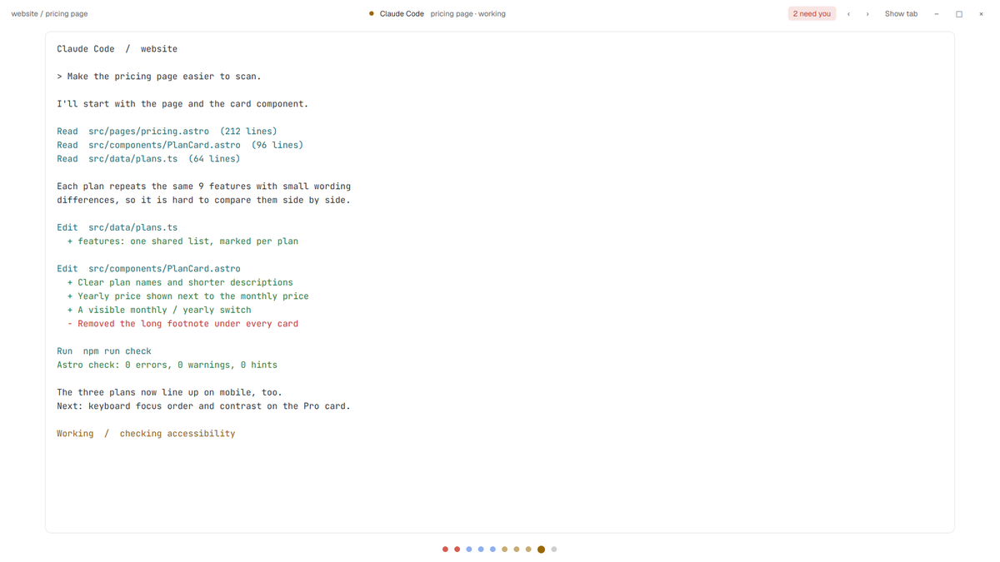
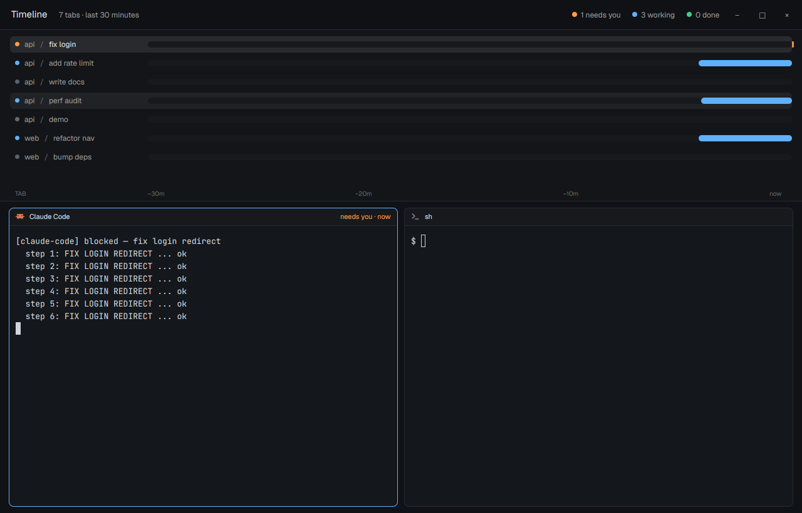
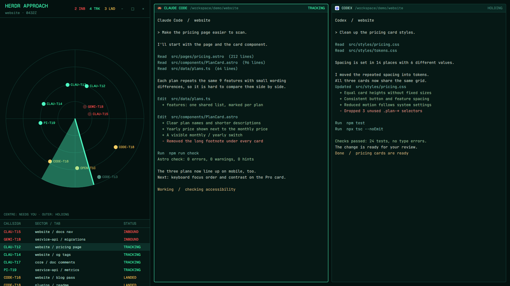
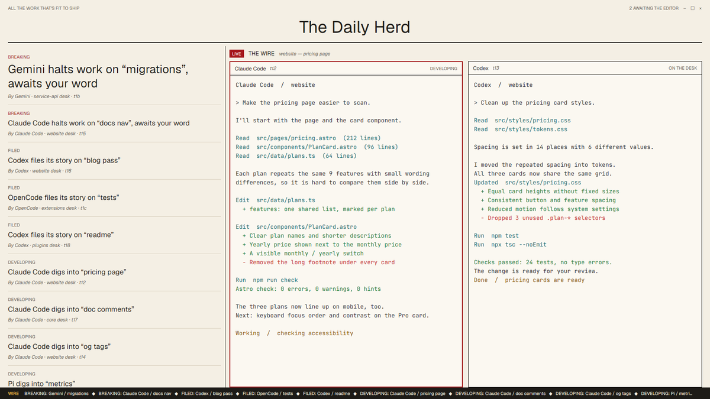
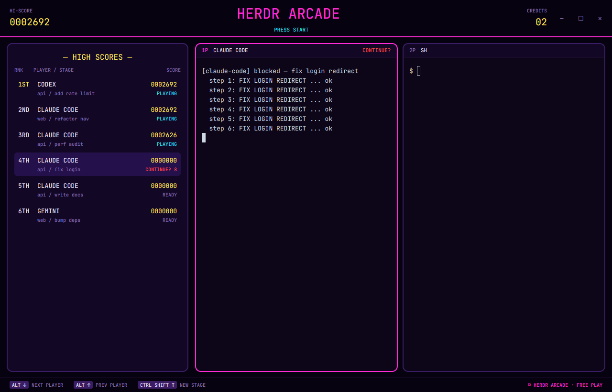
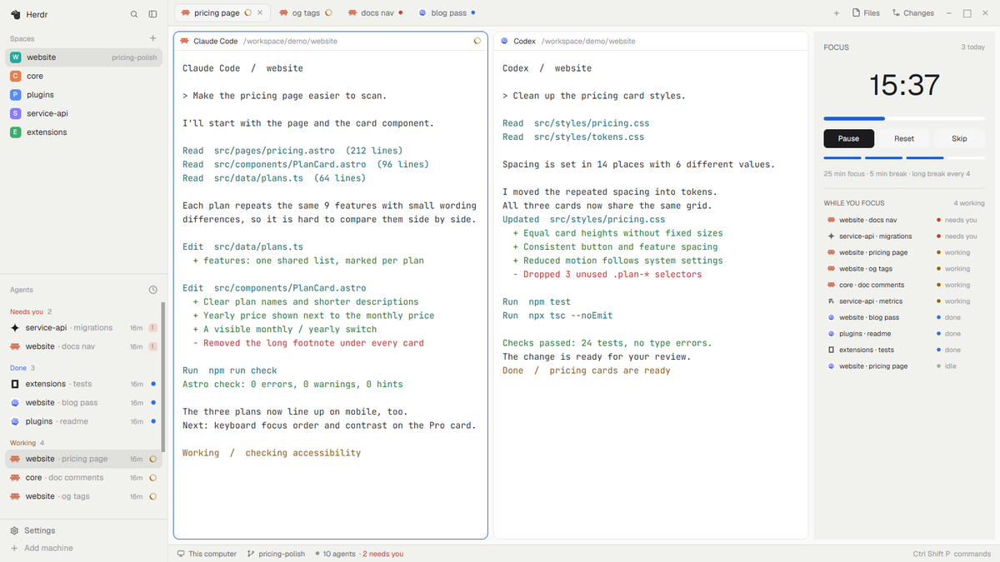
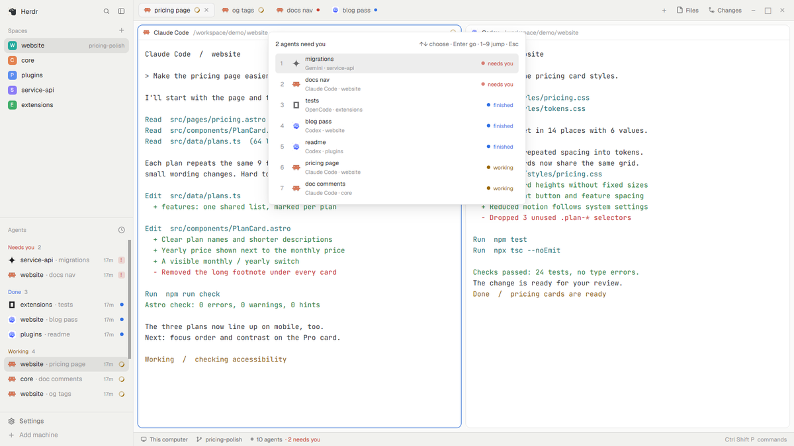
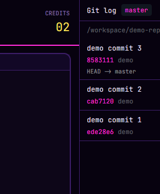
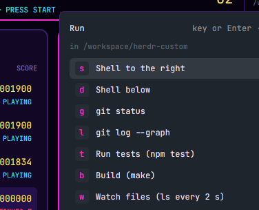
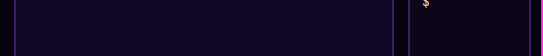

# herdr-custom

Five layouts and five mods for **Herdr**, the desktop app for terminals and coding
agents (`herdr-app`, herdr.dev), built in the same shape as
[herdrdev/herdr-layout-examples](https://github.com/herdrdev/herdr-layout-examples).
Each folder is laid out like the app home (`~/.config/herdr-app`) and has a
`RECIPE.md` (the brief: what it is, how it behaves, what it is built from) and a
`preview.png` (a real `herdr-app shot`).

> **Which Herdr?** Layouts and mods belong to the **Herdr desktop app** (`herdr-app`,
> versions 0.1.x, home `~/.config/herdr-app`). They do **not** apply to the older
> **Herdr TUI** (`herdr`, versions 0.9.x, config `~/.config/herdr/config.toml`), which has
> plugins and a TOML config instead. Built and tested on herdr-app **0.1.10** with
> herdr-core (`hc`) **0.1.15**.

## Layouts

A layout replaces the whole window: `layouts/<name>.json` (a tree of rows, columns,
stacks and blocks) plus the mod that draws its blocks.

| Layout | |
| --- | --- |
| [Zen](zen/) | One agent at a time, centred and distraction-free; a dot per agent along the bottom, a toggle to the full tab |
| [Timeline](timeline/) | A swimlane per tab showing working / needs-you / done over the last 30 minutes, live terminals below |
| [Radar](radar/) | Air-traffic control: agents as blips on a spinning scope, the ones that need you inbound at the centre |
| [Newsroom](newsroom/) | A broadsheet: blocked agents are BREAKING headlines, the live tab is the wire desk, a ticker at the bottom |
| [Arcade](arcade/) | A neon cabinet: agents score points while working, stage-clear bonuses, a CONTINUE? countdown when blocked |

## Mods

A mod is a piece you add to your current layout, not a whole window. Mod folders
have no `layouts/` folder.

| Mod | Where | |
| --- | --- | --- |
| [Pomodoro](pomodoro/) | right panel, 260px | 25/5 focus timer with long breaks, notifications and a daily round count |
| [Needs you](needs-you/) | popup, Ctrl+Shift+J | Agents waiting on you first, then finished, then working; Enter or 1–9 to jump |
| [Git log](git-log/) | right panel, 340px | The focused terminal's repo history, following focus; click a commit to open its diff in a split |
| [Run menu](run-menu/) | popup, Ctrl+Shift+R | One-key launchers (shell, git status, tests, build, htop) in the focused folder |
| [Agent ticker](agent-ticker/) | bottom strip, 28px | Status counts and a clickable pill per agent, with time spent working |

## Screenshots

Real `herdr-app shot` captures from a test run with six demo agents.

<table>
  <tr>
    <td align="center" width="33%"><a href="zen/"></a><br><b>Zen</b> <sub>layout</sub></td>
    <td align="center" width="33%"><a href="timeline/"></a><br><b>Timeline</b> <sub>layout</sub></td>
    <td align="center" width="33%"><a href="radar/"></a><br><b>Radar</b> <sub>layout</sub></td>
  </tr>
  <tr>
    <td align="center" width="33%"><a href="newsroom/"></a><br><b>Newsroom</b> <sub>layout</sub></td>
    <td align="center" width="33%"><a href="arcade/"></a><br><b>Arcade</b> <sub>layout</sub></td>
    <td align="center" width="33%"><a href="pomodoro/"></a><br><b>Pomodoro</b> <sub>mod</sub></td>
  </tr>
  <tr>
    <td align="center" width="33%"><a href="needs-you/"></a><br><b>Needs you</b> <sub>mod</sub></td>
    <td align="center" width="33%"><a href="git-log/"></a><br><b>Git log</b> <sub>mod</sub></td>
    <td align="center" width="33%"><a href="run-menu/"></a><br><b>Run menu</b> <sub>mod</sub></td>
  </tr>
  <tr>
    <td align="center" width="33%"><a href="agent-ticker/"></a><br><b>Agent ticker</b> <sub>mod</sub></td>
    <td width="33%"></td>
    <td width="33%"></td>
  </tr>
</table>

## Install

You need the Herdr desktop app (it installs `herdr-app` and `hc` into `~/.local/bin`):

```sh
curl -fsSL https://releases.herdr.dev/app/install.sh | sh     # or Herdr.dmg on Apple Silicon
herdr-app --version                                            # 0.1.10 or newer
```

The app home is `~/.config/herdr-app` on macOS, Linux and Windows alike
(`$HERDR_APP_HOME`, or `$XDG_CONFIG_HOME/herdr-app`, override it). Open Herdr once so it
creates the home.

### With the script

```sh
git clone <this repo> herdr-custom && cd herdr-custom
./install.sh zen pomodoro          # or: ./install.sh --all
```

It copies `layouts/*.json` and `mods/<name>/` into the home, moves any file of the same
name to `~/.config/herdr-app/backup/herdr-custom-<time>/`, runs `herdr-app check` on each
mod, and prints the keys to merge for mods that have a `keys.json`. It never edits your
`keys.json`.

### By hand

```sh
H=~/.config/herdr-app
# a layout (zen, timeline, radar, newsroom, arcade)
cp zen/layouts/zen.json "$H/layouts/" && cp -R zen/mods/zen "$H/mods/"
# a mod (pomodoro, needs-you, git-log, run-menu, agent-ticker)
cp -R pomodoro/mods/pomodoro "$H/mods/"
herdr-app check "$H/mods/pomodoro"         # "check passed: …"
```

For `needs-you` and `run-menu`, merge their `keys.json` into `~/.config/herdr-app/keys.json`
(add the entries to the existing `global`, `terminal` and `mod:<name>` sections; keep your
other keys).

## Use

Herdr watches its home, so nothing needs a reload: new layouts show up in
Settings by themselves, and saved mods reload live.

```sh
herdr-app do layout.switch --name zen      # show a layout (or pick it in Settings)
herdr-app do layout.switch --name main     # back to the default
herdr-app do mod.open --name needs-you     # open a popup mod (or press its key)
herdr-app status                           # current layout, overlays and any mod errors
herdr-app shot ~/Desktop/herdr.png         # a picture of the window
```

Panel mods (`pomodoro`, `git-log`, `agent-ticker`) dock themselves, per their `mod.json`,
into **whichever layout is shown the first time Herdr sees the folder**; after that the
layout keeps them. So switch to the layout you want them in (e.g. `main`) before copying
them in. Close a docked panel like any pane.

To remove an item, delete its `layouts/<name>.json` and `mods/<name>/` from the home (and
its keys).

## Repo layout

```
<item>/
├── RECIPE.md            the brief
├── preview.png          a screenshot
├── layouts/<item>.json  layouts only
├── mods/<item>/         main.js, mod.json (+ svgs)
└── keys.json            mods with a shortcut only
```

See [CATALOG.md](CATALOG.md) for the layouts and mods that already existed when these
were made.

## Validation

- All JSON parses; every mod passes `herdr-app check` (herdr-app 0.1.10).
- Every layout was shown with `herdr-app do layout.switch` in an isolated home
  (`HERDR_APP_HOME`) with fake agents reporting OSC 7501 status, and `herdr-app status`
  reported no errors. The preview images are those runs.
- The popups were opened with `mod.open` and driven with keys (Needs you → Enter focused
  the agent; Run menu → `g` opened `git status` below), and Git log was clicked through
  to a diff.
- Not tested on macOS itself: the traffic-light offsets (`traffic_lights`) and the ⌘ key
  labels are from the docs and the shipped layouts.
