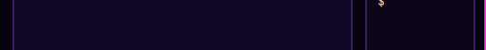

# Agent ticker

A one-line status strip along the bottom of any layout: how many agents need you, are working or are done, and a pill per agent you can click.

This file is the brief: enough to build Agent ticker from an empty folder. The files next to it are one build of it. If they don't work on your Herdr, or you want it different, build it again from here.

## What you see

- A 28px strip at the bottom (`place: "bottom"`), chrome background with a top border, 11px text.
- Counts with colored dots: “1 need you”, “3 working”, “0 done” (dim when zero), a divider, then up to 12 pills: program icon, tab name, status dot (pulsing when blocked) and, for working agents, how long they've been at it (`<1m`, `12m`, `1h05`). A blocked pill gets a status-colored border; the focused one is highlighted. “+N” if there are more.

## How it behaves

- Pills are ordered Needs you → Done → Working → Idle. Clicking a pill, or a count, runs `agent.focus` on that agent (the first one in that status).
- Elapsed times refresh every 30s; status changes are live.

## Built from

- `mods/agent-ticker/` with `main.js` and `mod.json` (`{"place":"bottom","size":28,"title":"Agent ticker"}`).
- APIs: `agents()`, `spaces()` (tab `working_since`), `run()`, `theme()`, `.loop("opacity", …)`.

## Watch out

- Docks into the layout shown when Herdr first sees the folder; layouts that draw their own bottom bar may already be busy there.

## Done when

- `herdr-app check mods/agent-ticker` passes.
- The strip shows the right counts; making an agent ask a question adds a pulsing pill at the front; clicking it shows that agent.
