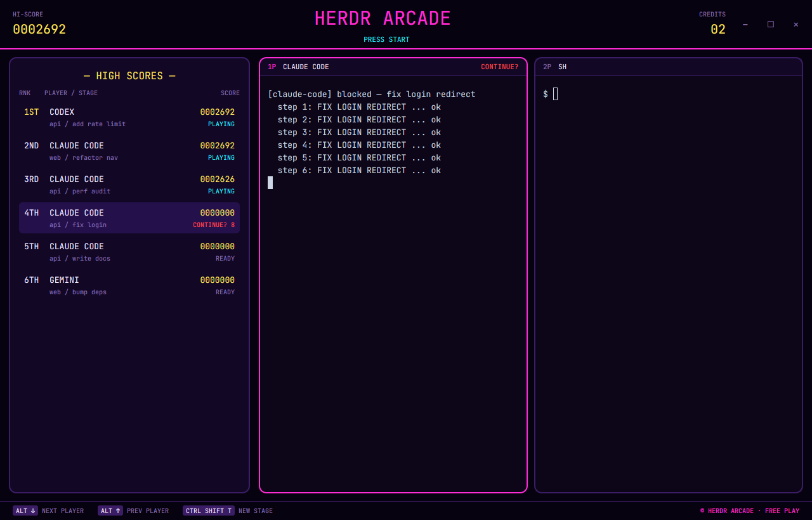

# Arcade

An 80s arcade cabinet for your agents. Working agents rack up points, finishing a job is a stage-clear bonus, and one that needs you flashes CONTINUE? with a countdown.

This file is the brief: enough to build Arcade from an empty folder. The files next to it are one build of it. If they don't work on your Herdr, or you want it different, build it again from here.

## What you see

- Ink theme with neon colors: background `#07020f`, pink `#ff2bd6`, cyan `#29f0ff`, yellow `#ffe95c`. JetBrains Mono everywhere. No system title bar.
- A 78px marquee: HI-SCORE on the left, “HERDR ARCADE” in pink with a blinking “▶ PRESS START”, CREDITS (agent count) on the right, a 2px pink rule.
- The cabinet, inset 12×14px: a 380px HIGH SCORES panel and the active tab's panes, 2px borders and 12px radius, pink when focused. Pane headers read `1P CLAUDE CODE`, `2P SH`.
- HIGH SCORES: rank (1ST, 2ND…), player (program), stage (`space / tab`), a seven-digit score and a state: PLAYING, STAGE CLEAR, READY, or a flashing “CONTINUE? 9…1”.
- A 30px controls strip with the real keys for next/previous agent and new tab (Alt+↓/↑ and Ctrl+Shift+T; ⌘] ⌘[ ⌘T on macOS).

## How it behaves

- Score = 10 points per second of the current working stretch (from the tab's `working_since`) plus 5000 for each working → done seen while the layout is shown. Scores refresh every 5s.
- The table is ranked by score; next/previous agent keys follow it. Clicking a row runs `agent.focus`; clicking a pane header focuses the pane.
- The blinking and countdown are native `.frames()` animations; nothing redraws the view to animate.

## Built from

- `layouts/arcade.json`: `column` root, `titlebar: "none"`, `traffic_lights`, `theme: "ink"`, `font`, `ui_font`, `colors`. `arcade-marquee` (78px, `window_drag`, role `marquee`), `arcade-cabinet` row (`arcade-scores`, no role; `arcade-screen` = `{tab:"active", pane:{header: role "pane"}}`), `arcade-controls` (30px, role `controls`).
- `mods/arcade/`: one mod; bonuses kept in a module-level map.

## Watch out

- Bonuses are in memory: they reset when the mod reloads or Herdr restarts. The countdown loops; nothing happens at 1.

## Done when

- `herdr-app check mods/arcade` passes; `layout.switch --name arcade` shows no errors.
- Working agents' scores climb every few seconds; a blocked agent shows the CONTINUE? countdown; the controls strip shows ⌘ keys on macOS.
