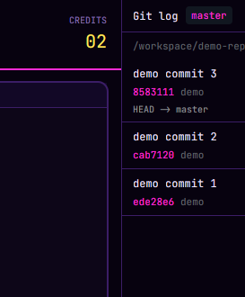

# Git log

The last 40 commits of whatever repo your focused terminal is in, next to your work. Click one to read it in a split.

This file is the brief: enough to build Git log from an empty folder. The files next to it are one build of it. If they don't work on your Herdr, or you want it different, build it again from here.

## What you see

- A 340px panel on the right (`place: "right"`), titled Git log.
- A header with “Git log”, the branch in an accent chip and a ↻ refresh button; the repo folder (shortened) underneath.
- One row per commit: subject, short hash in the accent color, author and relative date, and refs (`HEAD → main, origin/main`) when present.
- “Not a git repository”, “No commits yet” or git's first error line when there is nothing to show.

## How it behaves

- Follows focus: every 1.5s it compares the focused terminal's folder (and machine) with the last one and runs git only when it changed. It also refreshes every 20s and on ↻.
- git runs with `exec` in that folder on that terminal's machine (`on: machine`), so remote spaces work.
- Clicking a commit opens a terminal to the right running `git show --stat --patch <hash>` (your pager), then drops to your shell.

## Built from

- `mods/git-log/` with `main.js` and `mod.json` (`{"place":"right","size":340,"title":"Git log"}`).
- APIs: `focused()`, `panes()`, `exec()`, `run("terminal.open", {argv, folder, place})`, `cx.spawn`, `cx.timer.every`. No work is started from `render`.

## Watch out

- Needs `git` on the machine the terminal runs on.
- A terminal whose shell doesn't report its folder (OSC 7) is followed by its space folder instead.

## Done when

- `herdr-app check mods/git-log` passes.
- Focusing a terminal in a repo lists its commits within two seconds; clicking one opens the diff to the right.
