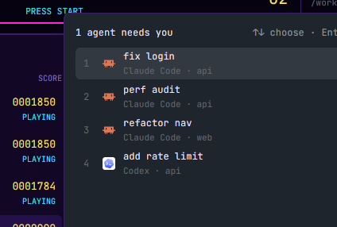

# Needs you

One key shows every agent waiting on you, then the ones that just finished, then the ones still working. Pick one and you're there.



This file is the brief: enough to build Needs you from an empty folder. The files next to it are one build of it. If they don't work on your Herdr, or you want it different, build it again from here.

## What you see

- A popup near the top, 520×360px, offset 64px. Nothing is added to the layout.
- A heading (“2 agents need you” or “Nobody is waiting on you”) with “↑↓ choose · Enter go · 1–9 jump · Esc” on the right.
- A 290px scrolling list: number, program icon, tab name, program · space, and a status dot and word (needs you / finished / working). Blocked dots pulse.

## How it behaves

- Ctrl+Shift+J opens it from anywhere (terminal included). Pressing Ctrl+Shift+J again while it is open moves down the list (`needs-you.next`).
- ↑/↓ or j/k move, Enter or 1–9 runs `agent.focus` and closes the popup, Esc closes it. Idle agents are hidden (`SHOW_IDLE`).

## Built from

- `mods/needs-you/` with `main.js` and `mod.json` (`place: "none"`, `overlay: {kind:"popup", at:"top", offset:64, width:520, height:360}`).
- A `keys.json` snippet to merge into your own:

  ```json
  {
    "global": { "ctrl-shift-j": "mod.open:needs-you" },
    "terminal": { "ctrl-shift-j": "mod.open:needs-you" },
    "mod:needs-you": { "ctrl-shift-j": "needs-you.next" }
  }
  ```
- A focusable view (`cx.focus_handle()` in `init`), `nextCommand()` for the mod command, `closeOverlay(props().overlay)`.

## Watch out

- Ctrl+Shift+J is taken away from terminal programs. Merge the snippet; don't replace your keys.json.
- The popup is fixed-size; with more than 7 agents the list scrolls.

## Done when

- `herdr-app check mods/needs-you` passes.
- Ctrl+Shift+J (or `herdr-app do mod.open --name needs-you`) opens it with blocked agents first; Enter shows the selected agent and closes the popup; Esc closes it.
