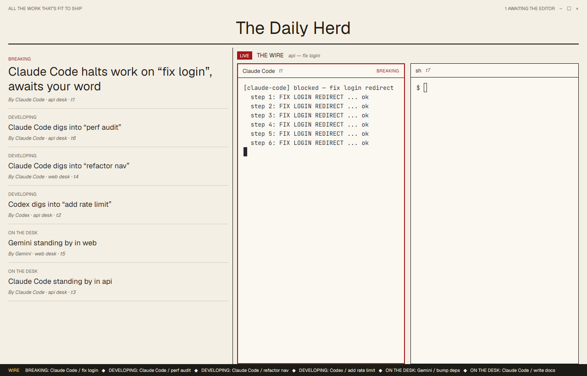

# Newsroom

Your agents as a broadsheet. Whoever needs you is BREAKING news on the front page; finished work is FILED; the live tab is the wire desk, and a ticker runs along the bottom.

This file is the brief: enough to build Newsroom from an empty folder. The files next to it are one build of it. If they don't work on your Herdr, or you want it different, build it again from here.

## What you see

- Paper theme, cream `#f4efe4`, ink `#1d1b17`, red `#a4161a`. No system title bar.
- A 104px masthead: “ALL THE WORK THAT'S FIT TO SHIP” and a count of agents awaiting you, then “The Daily Herd” in large extrabold type, the date line and a heavy rule.
- The body, 18px side margins: the front page on the left (480px, drag 320–760px) and the wire on the right, with a 1px ink divider.
- Front page: one story per agent. A kicker (BREAKING, FILED, DEVELOPING, ON THE DESK), a headline (“Claude Code halts work on “fix login”, awaits your word”), and an italic byline (`By Claude Code · api desk · t1`). The top story is larger.
- The wire: a 34px “LIVE · THE WIRE · space — tab” strip and the active tab's panes, each with a byline header (program and address) and a red border when blocked.
- A 26px black ticker at the bottom with every story's kicker and headline.

## How it behaves

- Stories are ordered Breaking → Filed → Developing → On the desk, newest first within each; the app's next/previous agent keys follow that order.
- Clicking a story runs `agent.focus`; clicking a pane byline focuses the pane. The date refreshes every minute.

## Built from

- `layouts/newsroom.json`: `column` root with `titlebar: "none"`, `traffic_lights`, `theme: "paper"`, `colors`. `newsroom-masthead` (104px, `window_drag`, role `masthead`), `newsroom-body` row (`newsroom-front` with no role; `newsroom-wire` column of `newsroom-section` role `section` and `newsroom-live` = `{tab:"active", pane:{header: role "pane"}}`), `newsroom-footer` (26px, role `footer`).
- `mods/newsroom/`: one mod with five roles. Text styling with `.italic()`, `.font_extrabold()`, `.line_height()`.

## Watch out

- Headlines are built from the program name, tab name and status, so name your tabs.
- The ticker is static text, not a scrolling animation.

## Done when

- `herdr-app check mods/newsroom` passes; `layout.switch --name newsroom` shows no errors.
- A blocked agent leads the front page as BREAKING and its pane has a red border; clicking a story shows that agent.
