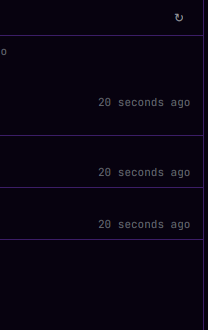

# Pomodoro

A focus timer docked beside your terminals: 25 minutes of work, 5 of break, a long break every four rounds, and a nudge that tells you how many agents kept working while you rested.

This file is the brief: enough to build Pomodoro from an empty folder. The files next to it are one build of it. If they don't work on your Herdr, or you want it different, build it again from here.

## What you see

- A 260px panel on the right (`place: "right"`), titled Pomodoro.
- FOCUS / BREAK / LONG BREAK label and “N today” on top; a large `mm:ss` clock; a 6px progress bar that eases as it fills; Start/Pause, Reset and Skip buttons; four round markers; a one-line summary of the settings.
- Your theme's colors; the accent marks focus, green marks breaks.

## How it behaves

- Start runs a one-second `cx.timer.every` ticker; Pause cancels it, so nothing runs while paused.
- At the end of a phase: a notification (“Focus round done — take a break: 2 agents keep working.”) and the `done` sound, then the next phase is loaded, not started.
- Finished focus rounds for today are stored in `shared("pomodoro.rounds")`, so the count survives a restart.

## Built from

- `mods/pomodoro/` with `main.js` and `mod.json` (`{"place":"right","size":260,"title":"Pomodoro"}`). No layout change.
- APIs: `cx.timer.every` / `Task.cancel()`, `shared` / `setShared`, `notify`, `playSound`, `agents()`, `theme()`, `.transition("width", 900)`.
- Customize with `FOCUS_MIN`, `BREAK_MIN`, `LONG_BREAK_MIN`, `LONG_EVERY` at the top of `main.js`.

## Watch out

- A running timer restarts at its phase start if the mod reloads (saving the file, restarting Herdr).
- Herdr docks the panel into the layout that is shown the first time it sees the folder; after that the layouts decide.

## Done when

- `herdr-app check mods/pomodoro` passes.
- Start counts down; Pause stops it; Skip moves to the break; finishing a round notifies and plays a sound and “today” goes up.
