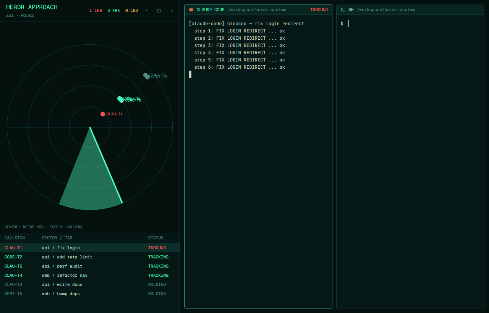

# Radar

Air-traffic control for your agents. A spinning sweep finds them on a green scope: the ones that need you are inbound at the centre, idle ones holding on the outer ring.

This file is the brief: enough to build Radar from an empty folder. The files next to it are one build of it. If they don't work on your Herdr, or you want it different, build it again from here.

## What you see

- A 470px left column (drag 360–720px) and the active tab on the right, split by a 1px `#14423a` divider. Moss theme, JetBrains Mono terminals, Geist Mono UI, near-black green `#04110f`.
- Left column, top to bottom: a 56px header (“HERDR APPROACH”, the space name and a Zulu clock, then counts `INB / TRK / LND`); the scope; a 210px contacts table.
- The scope: four concentric rings, crosshairs and an SVG sweep wedge spinning every 4s. Each agent is a 12px blip with a callsign label (`CLAU-T1`): blocked on the inner ring (pulsing red), working next, done next, idle outermost. The angle comes from a hash of the terminal address, so blips don't jump.
- Contacts: CALLSIGN, SECTOR / TAB and STATUS (INBOUND, TRACKING, LANDED, HOLDING) for every agent, most urgent first.
- Pane headers in the work area show the program and “INBOUND” when that agent is blocked.

## How it behaves

- Clicking a blip or a contact runs `agent.focus`. The next/previous agent keys follow the contacts order (`setAgentOrder`).
- The rings rescale with the block (`on_size_change`); the sweep is a native `.spin(4000)` animation, so no timer redraws the view. The header clock refreshes every 30s.

## Built from

- `layouts/radar.json`: `row` root, `titlebar: "none"`, `traffic_lights`, `theme: "moss"`, `font`, `ui_font`, `colors`, `divider`. `radar-side` column with blocks `radar-top` (role `top`, `window_drag`), `radar-scope` (no role), `radar-contacts` (role `contacts`); then `radar-work` with `{tab:"active", pane:{header:{content:{mod:"radar", props:{role:"pane"}}}}}`.
- `mods/radar/`: `main.js`, `mod.json` (`place: "none"`), `sweep.svg` (the wedge, tinted with `svg()`), `preview.svg`.

## Watch out

- Callsigns use the first four letters of the program name; two agents of the same program differ by address.
- More than about 20 agents crowd the rings.

## Done when

- `herdr-app check mods/radar` passes; `layout.switch --name radar` shows no errors.
- The sweep turns; a blocked agent pulses in the centre and is first in Contacts; clicking it shows its terminal.
