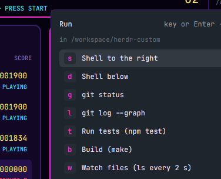

# Run menu

A launcher popup for the commands you start over and over: a shell beside you, git status below, the tests, a build, htop. One key each, in the focused terminal's folder.



This file is the brief: enough to build Run menu from an empty folder. The files next to it are one build of it. If they don't work on your Herdr, or you want it different, build it again from here.

## What you see

- A popup near the top, 460×380px, offset 64px.
- “Run” with “key or Enter · Shift: new tab · Esc”; the folder it will run in; then one row per launcher: a key badge, a label and where it opens (right, down, tab).

## How it behaves

- Ctrl+Shift+R opens it. A letter runs that launcher at once; ↑/↓ and Enter work too; Shift opens it in a new tab instead; Esc closes.
- Each launcher runs `terminal.open {argv, folder, place}` with `sh -c '<command>; exec $SHELL'`, so a short command like `git status` leaves its pane open on a shell. A blank launcher opens a plain shell.

## Built from

- `mods/run-menu/` with `main.js` and `mod.json` (`place: "none"`, popup overlay 460×380).
- A `keys.json` snippet:

  ```json
  {
    "global": { "ctrl-shift-r": "mod.open:run-menu" },
    "terminal": { "ctrl-shift-r": "mod.open:run-menu" }
  }
  ```
- The `ITEMS` array at the top of `main.js` is the whole configuration: `[key, label, command, place]`.

## Watch out

- Ctrl+Shift+R is taken away from terminal programs (some shells use Ctrl+R for history search; Ctrl+Shift+R is usually free).
- Commands are run through `sh -c`; quote accordingly.

## Done when

- `herdr-app check mods/run-menu` passes.
- Ctrl+Shift+R then `g` opens `git status` below the focused pane in its folder and leaves a shell there.
