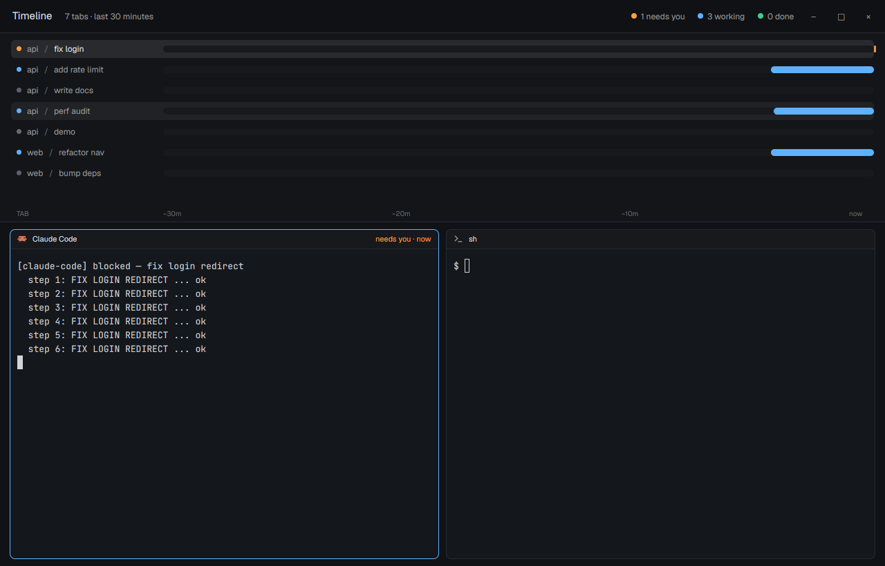

# Timeline

A swimlane per tab showing what each agent did over the last 30 minutes: working in blue, waiting on you in orange, done in green. Your live terminals sit underneath.

This file is the brief: enough to build Timeline from an empty folder. The files next to it are one build of it. If they don't work on your Herdr, or you want it different, build it again from here.

## What you see

- No system title bar. A 48px top bar: “Timeline”, “N tabs · last 30 minutes”, and three counts (needs you / working / done) with colored dots, plus window buttons where the system draws none.
- A 250px lane area (drag 120–520px): one 24px row per tab across all spaces, `space / tab` labels in a 220px column, and a track to the right where colored bars mark each status span. The currently blocked span pulses.
- A 24px ruler: `−30m`, `−20m`, `−10m`, `now`.
- The active tab's panes fill the rest, inset 10×14px, 8px radius, each with a 26px header (program, status and how long it has been in it).
- Graphite theme with custom colors: background `#14171c`, working `#5eb1ff`, blocked `#ff9f43`, done `#3ecf8e`, idle `#59616e`.

## How it behaves

- History starts when the layout is first shown: each status change of a tab opens a new span. Spans older than 30 minutes fall off.
- Lanes refresh every 15s (data only; no animation timers). Clicking a lane runs `space.select` then `tab.select`.
- Clicking a pane header focuses that pane.

## Built from

- `layouts/timeline.json`: `column` root, `titlebar: "none"`, `traffic_lights`, `theme: "graphite"` + `colors`. Blocks: `timeline-top` (48px, `window_drag`, role `top`), `timeline-lanes` (250px, `min` 120, `max` 520, no role), `timeline-ruler` (24px, role `ruler`), `timeline-work` (`{tab:"active", pane:{header:{content:{mod:"timeline", props:{role:"pane"}}, height:26}}}`).
- `mods/timeline/`: a module-level `Map` keeps spans per tab id so all copies share one history; sizes come from `.on_size_change`.
- APIs: `spaces()` (tabs with `status`, `working_since`), `panes()`, `run()`, `theme()`, `cx.timer.every`.

## Watch out

- History lives in memory only: it is empty after a restart or a reload of the mod.
- Tabs report one status (the most urgent of their terminals).
- Very many tabs scroll inside the 250px area; drag the divider to see more.

## Done when

- `herdr-app check mods/timeline` passes; `layout.switch --name timeline` shows no errors in `herdr-app status`.
- Starting an agent draws a blue bar that grows to the right; making it ask a question turns the end orange and pulsing.
- Clicking a lane jumps to that tab.
