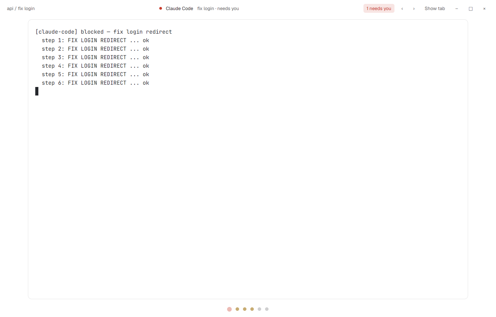

# Zen

One agent at a time, centred, with nothing else on screen. A thin bar names it and says how many others need you; a row of dots along the bottom is everyone else.

This file is the brief: enough to build Zen from an empty folder. The files next to it are one build of it. If they don't work on your Herdr, or you want it different, build it again from here.

## What you see

- No system title bar. A 44px bar on top: `space / tab` on the left; the shown agent's status dot, program name, tab name and status in the middle; a red “N needs you” chip when anyone is blocked; `‹` `›` buttons; a “Show tab” / “Show agent” toggle; and window buttons on Linux and Windows. On macOS the bar leaves 84px for the traffic lights at `[18, 16]`.
- The body, inset 6px top/bottom and 72px left/right, is a stack. By default it shows the focused agent's terminal alone (`{"agent": "focused"}`) in a 10px-radius frame with a 1px border. The toggle swaps to the whole active tab, panes separated by 10px gaps with an accent focus border.
- A 40px strip of dots at the bottom: one 10px dot per agent in status color, the shown one larger with a ring. Blocked dots pulse.
- Theme `paper` in light mode and `ink` in dark, Geist UI font, 14px terminal text with 18×14px terminal padding.

## How it behaves

- Dots are sorted Needs you → Done → Working → Idle, and the app's next/previous agent keys follow that order (`setAgentOrder`). Clicking a dot runs `agent.focus`.
- `‹` and `›` run `agent.prev` / `agent.next`. The toggle runs `layout.select {stack: "zen-body", child}`.
- Everything is live: status, names and counts change as agents report OSC 7501.

## Built from

- `layouts/zen.json`: a `column` root with `titlebar: "none"`, `traffic_lights`, `theme: {light, dark}`, `resizable: false`, `movable: false`. Children: `zen-top` (block, 44px, `window_drag`, mod `zen` with `props.role = "top"`), `zen-body` (stack, `active: "zen-agent"`, children `zen-agent` = `{agent:"focused"}` and `zen-tab` = `{tab:"active", pane:{…}}`), `zen-dots` (block, 40px, `role: "dots"`). `preview: "mods/zen/preview.svg"`.
- `mods/zen/`: one mod rendering both roles from `props().role`; `mod.json` is `{"place":"none"}` so it only appears where the layout puts it.
- APIs: `agents()`, `spaces()`, `focused()`, `theme()`, `window()`, `run()`, `setAgentOrder()`, `.loop("opacity", …)`.

## Watch out

- With no agents running the body shows an empty frame; switch to “Show tab” to see plain terminals.
- The toggle's state is per copy of the mod; switching layouts resets it to the agent view.
- The 72px side inset is fixed; narrow windows get a narrow terminal.

## Done when

- `herdr-app check mods/zen` passes.
- `herdr-app do layout.switch --name zen` shows the bar, the focused agent and the dots, and `herdr-app status` reports no errors.
- A blocked agent's dot pulses and the bar shows “1 needs you”; clicking any dot shows that agent; the toggle shows the full tab and back.
